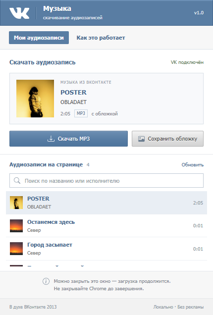
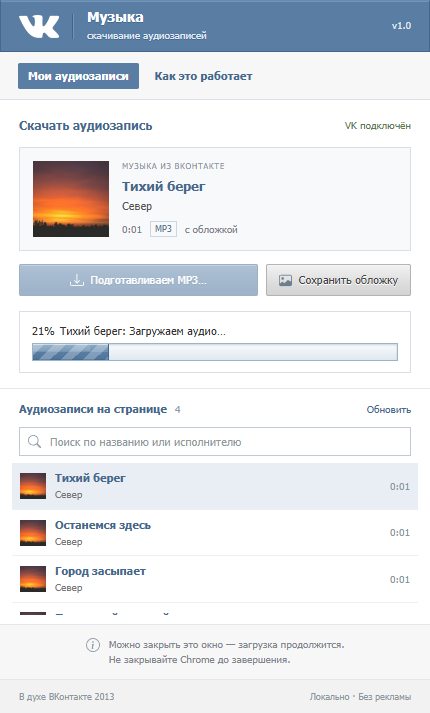

# VK Music Downloader — 2013

Chrome Manifest V3 extension for downloading VK audio as MP3, with title, artist and available cover art. The popup uses the supplied VK 2013 design: blue header, Tahoma typography, compact panels and original button artwork.



[Download the Chrome extension ZIP](vk-music-downloader.zip)

## Install

1. Open `chrome://extensions` in Google Chrome 116 or later.
2. Enable **Developer mode**.
3. Click **Load unpacked** and select the extracted ZIP folder containing `manifest.json`, or this project's `dist` folder after building from source.
4. Reload existing VK tabs. Sign in to VK normally and open **Music** on `vk.com` or `vk.ru`.
5. Open the extension, select a track, and click **Скачать MP3**. Alternatively, use **Скачать MP3** beside an audio row on VK.

`vk-music-downloader.zip` contains the same loadable extension. Extract the entire archive before loading its folder. Chrome does not install this ZIP directly.

After changing the source, rebuild and click **Reload** on the extension card in `chrome://extensions`. Close and reopen the popup to see updated styling; reload VK pages to update their buttons.

## Behavior

- Reads the signed-in page's audio rows and current VK player. The popup lists up to 100 loaded rows plus the current track, with search and track selection. Scroll VK to load additional records, then click **Обновить**.
- Adds a download button to each supported VK audio row, including rows inserted or reused during client-side navigation.
- Downloads available progressive MP3 or finite HLS audio. AAC is converted to an actual MP3 using the bundled FFmpeg WebAssembly engine. Existing MP3 audio is preserved without re-encoding.
- Supports ordinary HLS AES-128 delivery using the key supplied by the playback playlist. DRM and SAMPLE-AES are unsupported.
- Writes Unicode title, artist, source URL and JPEG/PNG cover into ID3v2.3 metadata. WebP/AVIF covers are converted locally. An unavailable cover does not prevent audio from being saved.
- Reads cover art from album thumbnail objects, legacy records, computed row styles and lazy images. Covers survive incomplete player-cache records. Signed crop parameters remain intact; another actual track thumbnail is tried when a larger image is unavailable, both in the popup and during MP3 tagging.
- Reads the current player's `img[alt="Обложка аудиозаписи"]` even outside legacy audio rows, including images served from `vkuserphoto.ru`. The current-player cover is associated only with that track; signed image URLs are preserved.
- Offers a separate cover download and a **Показать в папке** button after MP3 completion.
- Keeps processing in a Chrome offscreen document when the popup closes. Keep Chrome open until completion. One audio recording is processed at a time; filenames are made unique automatically.
- Shows the original Wormix/VK 2013 progress style: an 18px inset track, striped blue gradient, animated highlight and visible percentage. Overall progress combines received audio bytes or HLS segments, conversion, tagging and saving. It reaches 100% only when Chrome confirms the file was saved. Errors stop the animation at the last reported percentage; reopening the popup restores the job. Reduced-motion preferences disable the animation.



The extension resolves masked playback URLs locally, including viewer-specific links. Playback does not have to start before downloading. For records without a ready URL, it requests playback metadata using the record's page-provided hashes and your existing signed-in session. Both legacy array records and newer object records are supported, including nested JSON reload responses and pages without the global `ajax` helper. It never asks for an account password or developer token. If VK still does not provide a full recording, the extension reports that response instead of repeatedly asking you to start playback.

Previews, unavailable full recordings, DRM, live broadcasts, byte-range HLS and files over 200 MB are unsupported. VK changes its internal player and page structure; layouts without the supported `data-full-id` audio rows depend on the current player record being accessible. Compatibility with every VK layout is not guaranteed. Save only audio you have permission to download.

## Development

```powershell
npm.cmd ci
npm.cmd run build
npm.cmd test
npm.cmd run test:browser
npm.cmd run package
```

`extension/` contains editable source. `dist/` contains the complete unpacked extension, including all runtime code, icons and the FFmpeg engine. Building requires no requests beyond installed npm dependencies and the checked-in assets.

`npm.cmd run dev` serves an explicit popup preview at `http://localhost:4173/?preview`. Sample metadata is confined to this preview; installed extensions display only the current VK page's records. Preview download controls explain that the extension must be installed.

Use `http://localhost:4173/?preview&progress=21` to inspect the classic progress bar, or `progress=100` for its completed state. These explicit preview states do not start downloads or simulate progress in the installed extension.

Browser validation uses Chrome for Testing with an isolated temporary profile, locally generated audio and intercepted VK fixture responses. It exercises content injection, popup controls, Chrome downloads, HLS conversion, artwork tagging and popup-independent processing. **These fixture checks are separate from verification against a real signed-in VK account.** Browser reports and screenshots are written to `artifacts/`.

The browser test finds Chrome for Testing in `.browsers/` or the supplied SoundCloud project's `.browsers/`. You can override it with `CHROME_PATH`, or install a local test browser:

```powershell
npx.cmd @puppeteer/browsers install chrome@stable --path .browsers
```

The supplied POSTER cover photo is included in `tests/fixtures/player-cover.jpg` so the artwork regression test works from a fresh checkout. It is test data and is never used as a default cover in the extension. Generated browser profiles, downloads and local test artifacts are excluded from Git.

## Privacy and permissions

Audio conversion and artwork tagging happen locally. There is no analytics, external converter or backend server. Media requests go to VK and the explicitly allowed VK media domains.

`activeTab` and `scripting` read the active VK page/player. VK host access permits content injection and media requests. `downloads` saves files and reveals completed MP3s. `storage` keeps temporary job progress; signed stream URLs are not persisted. `offscreen` keeps conversion running outside the popup. No remote JavaScript is downloaded or evaluated.

## Source and attribution

The audio-processing, ID3 and extension-job architecture was adapted from `D:\Projects\google-soundcloud-extension`. VK-specific page reading, row controls, popup and stream handling live in this project; the original project is unchanged.

The requested design was found at `C:\Users\Eduard\Desktop\spinula2\archive\vk-2013`, with the rendered dialog styles in `spinula2\src\app\globals.css`. Its logo and button sprite are preserved in `static/`. The build isolates sprite bands so taller buttons cannot show the adjacent gray band.

UI icons are Bootstrap Icons (MIT). The explicit preview photograph comes from the supplied SoundCloud project (Unsplash). FFmpeg includes GPL components. Third-party licenses and upstream source links are included in `dist/licenses/`. VK trademarks belong to their owners. This project is not affiliated with VK.

The local playback URL decoder was cross-checked against the [vk_api decoder implementation](https://github.com/python273/vk_api/blob/master/vk_api/audio_url_decoder.py) (python273, Apache-2.0). Its attribution and license are bundled with the extension.

Chrome API references: [offscreen documents](https://developer.chrome.com/docs/extensions/reference/api/offscreen), [script execution](https://developer.chrome.com/docs/extensions/reference/api/scripting).
